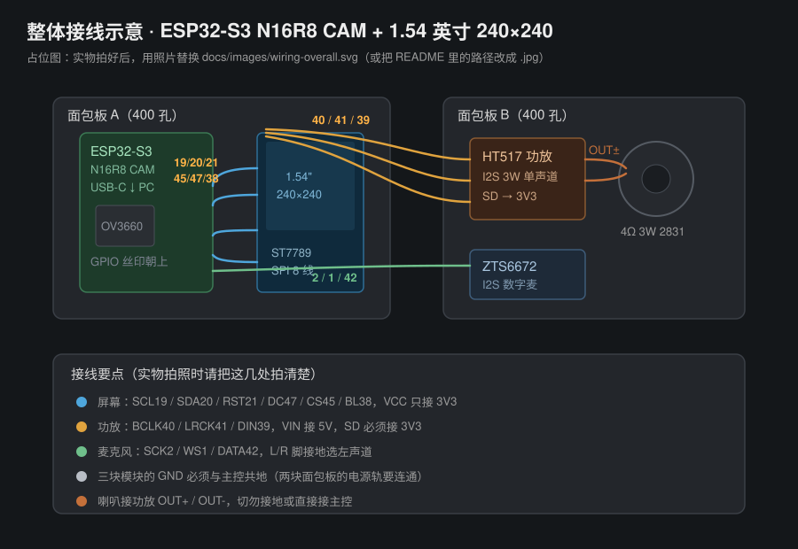
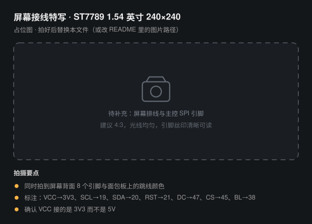
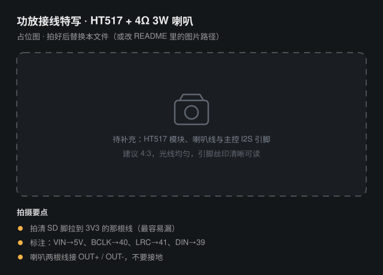
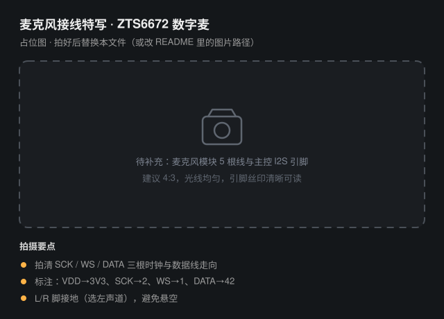
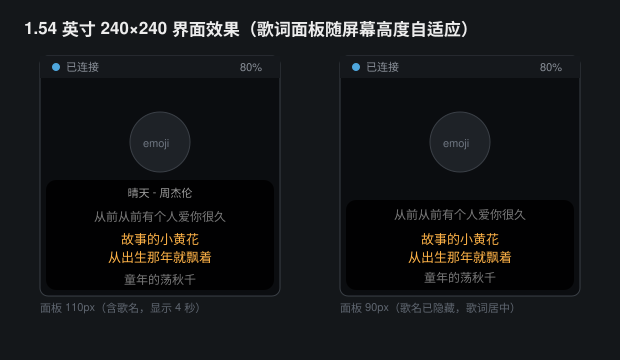

# 小智音乐播放器 · Meting 音源 + 实时歌词

基于 [虾哥 xiaozhi-esp32](https://github.com/78/xiaozhi-esp32) 与 [wuooo339/xiaozhimusic](https://github.com/wuooo339/xiaozhimusic) 的二次开发固件：在原有语音助手能力之上，接入 **Meting（网易云）公共音源**，做到「说一句话就能放歌」，并在 SPI 彩屏上以**全屏沉浸界面**实时显示歌词。

> 本仓库地址：<https://github.com/openclawyong/xiaozhimusic>（`wuooo339/xiaozhimusic` 为 fork 上游）。本仓库为个人改造版，**非上游官方版本**。默认硬件为「ESP32-S3 N16R8 CAM 开发板 + OV3660 摄像头 + ZTS6672 数字麦 + HT517 I2S 功放 + 1.54 寸 **240×240** SPI 彩屏」的面包板方案。

---

## 目录

- [特性](#特性) · [与上游的差异](#与上游的差异) · [硬件清单](#硬件清单) · [接线方案](#接线方案)
- [部署步骤](#部署步骤) · [使用](#使用) · [实现说明](#实现说明) · [可调参数](#可调参数)
- [常见问题](#常见问题) · [目录结构](#目录结构)

## 特性

| 能力 | 说明 |
|---|---|
| 🎵 语音点歌 | 说「放一首周杰伦的晴天」即搜索并播放，关键词自动提取（去掉「放一首」「的歌」等口语） |
| 🔊 320 kbps 音质 | Meting 以 `br=320` 取网易云直链（`type=url` 返回 302 → CDN 真实 MP3 地址） |
| 📜 实时歌词 | 拉取 LRC，按实际播放进度高亮当前行；**全屏沉浸歌词界面**（240×240 铺满整屏），当前行用高亮发光框 + 律动指示条 + 更亮荧光绿突出，上下行弱化衬托 |
| 🏷️ 歌名浮显 | 每首歌开头显示「歌名 - 歌手」4 秒后自动隐藏 |
| 🎙️ 播放中可打断 | 音乐播放时仍可喊「小智」唤醒并下指令（修复了唤醒任务被饿死的问题） |
| 📷 拍照识图 | OV3660 摄像头，说「看看这是什么」即可上传图片给大模型；改为**按需上电**（拍照时才初始化），与音乐播放互不抢资源 |
| 🔁 双解码器 | MP3 走 ESP-ADF `http_stream` + MP3 解码；M4A 走内置解码器，按 URL 自动分流 |
| 🌐 双音源实例 | 搜索与「直链/歌词」分别使用不同 Meting 实例，规避单个实例的搜索限流 |
| 🎨 主题切换 | 待机界面「科幻青」霓虹风（圆环 / HUD 角标 / 点阵），歌词界面「终端荧光绿」；语音「设置主题为科幻/深色/浅色」切换 |
| 🎚️ 音量修复 | 首次启动默认音量由 10 修正为 70（原值衰减后仅 1%，几乎无声） |

## 与上游的差异

- **音源**：由 `vkeys` 换为 Meting 公共实例（网易云），不再需要私有密钥。
  - 搜索：`https://met.liiiu.cn/meting/api`（失败自动重试一次 → 退回 `https://api.qijieya.cn/meting/`）
  - 直链 / 歌词：`https://api.qijieya.cn/meting/`
- **音质链路**：解码固定 44.1 kHz → 线性插值重采样到设备输出采样率（24 kHz），跨块保留相位与边界样本，长时间播放不漂移。
- **歌词**：新增 `LyricParser`（多维时间戳、间奏空行、元数据忽略、二分查找）+ **全屏歌词界面**（当前行高亮框突出，底部进度条 + 均衡器）。
- **唤醒**：`afe_wake_word` 检测任务优先级 3 → 7，避免音乐播放时「喂数据」任务占满 ringbuffer 导致喊不动；区分真唤醒与服务端 idle 告别，避免误停音乐导致「有回应没声音 / 歌播不完整」。
- **点歌**：拦截「音乐 / 歌曲」等泛词，拒绝泛搜，要求给出具体歌名（解决「总播放卡农」）。
- **摄像头**：改为按需上电 + 释放，开启 `CONFIG_CAMERA_PSRAM_DMA`，解决拍照 DMA 内存不足与常驻抢资源导致的无声 / 闪退。
- **稳定性**：HTTP 客户端补 `crt_bundle_attach`，解决 HTTPS 音频流的 `SSL_SETUP_FAILED`；播放队列加高水位限流，杜绝静默丢帧；MCP `tool_call` 线程栈从 PSRAM 改回内部 SRAM，修复 NVS 写 flash 关 cache 时的栈断言崩溃。
- **供电**：BOD 阈值调到 2.44 V（LVL7），缓解 USB 供电不足导致的欠压重启。
- **UI 主题**：新增科幻主题（一次性迁移默认开启），歌词面板配色跟随终端荧光绿风格。
- **SDK 版本**：官方 `main` 分支已升级到 ESP-IDF 6.0.1+，**本仓库固定在 ESP-IDF v5.4.4 + ESP-ADF v2.7**（ESP-ADF 目前只在 5.x 上验证可用）。请勿用 6.x 编译本仓库，否则 ADF 与 `http_stream` 组件会大量报错。

## 硬件清单

| # | 部件 | 型号 / 规格 | 数量 | 关键注意点 |
|---|---|---|---|---|
| 1 | 主控开发板 | **ESP32-S3 N16R8 CAM**（16 MB Flash / 8 MB Octal PSRAM），板载摄像头排座 | 1 | 必须是 **N16R8**：本固件分区表按 16 MB 布局，8 MB PSRAM 为 Octal 模式 |
| 2 | 摄像头 | **OV3660**（板载排线直插） | 1 | 由 `esp32-camera` 自动识别 PID，无需改代码；插反会识别成 `0x0` |
| 3 | 数字麦克风 | **ZTS6672** I2S 数字麦模块 | 1 | I2S 从机，需 SCK / WS / DATA 三线 + 3.3V；有 L/R 脚的接地选左声道 |
| 4 | 音频功放 | **HT517** I2S 音频功放模块（3 W 单声道） | 1 | `SD` 使能脚必须拉高，否则静音；建议 5 V 供电才有 3 W |
| 5 | 喇叭 | **4 Ω 3 W 2831 腔体喇叭** | 1 | 接功放 `OUT+ / OUT-`，不要接地 |
| 6 | 屏幕 | **1.54 寸 SPI 彩屏**（ST7789，**240×240**） | 1 | 本仓库默认按 240×240 编译；若实物是 240×320 / 240×280，需在 menuconfig 改 `LCD Type`，否则底部歌词面板会被裁掉 |
| 7 | 面包板 | 400 孔 | 2 | 一块放主控 + 屏幕，一块放功放 + 麦克风，减少走线干扰 |
| 8 | 导线 | 跳线一盒 / 杜邦线若干 | — | 建议 20 cm 以内；I2S 时钟线过长会引入杂音 |
| 9 | 数据线 | USB-C / Micro-USB 数据线（能传数据） | 1 | 只能充电的线会识别不到串口 |

> 整个系统只需要一路 5 V（USB）供电，功放与主控共地即可。

## 接线方案

### 引脚总表

对应 `main/boards/bread-compact-wifi-s3cam/config.h`，与 ESP32-S3 CAM 板的丝印 GPIO 编号一致。**改线必须同步改 `config.h`**。

**SPI 彩屏（ST7789）**

| 屏幕引脚 | ESP32-S3 | 说明 |
|---|---|---|
| VCC | 3V3 | 不要接 5 V |
| GND | GND | |
| SCL / CLK | GPIO19 | SPI 时钟 |
| SDA / MOSI | GPIO20 | SPI 数据 |
| RES / RST | GPIO21 | 复位 |
| DC | GPIO47 | 数据/命令选择 |
| CS | GPIO45 | 片选 |
| BLK / BL | GPIO38 | 背光，PWM 调光 |

**HT517 功放**

| 功放引脚 | ESP32-S3 | 说明 |
|---|---|---|
| VIN | 5V | 5 V 供电才出 3 W |
| GND | GND | 与主控共地 |
| SD | 3V3 | **使能脚，必须拉高**，悬空即静音 |
| BCLK | GPIO40 | I2S 位时钟 |
| LRC / LRCLK | GPIO41 | I2S 帧时钟 |
| DIN | GPIO39 | I2S 数据（主控 → 功放） |
| OUT+ / OUT- | 喇叭 + / - | 差分输出，不要接 GND |

**ZTS6672 数字麦克风**

| 麦克风引脚 | ESP32-S3 | 说明 |
|---|---|---|
| VDD | 3V3 | |
| GND | GND | |
| SCK / BCLK | GPIO2 | I2S 位时钟（主控输出） |
| WS / LRCLK | GPIO1 | I2S 帧时钟（主控输出） |
| SD / DATA | GPIO42 | I2S 数据（麦克风 → 主控） |
| L/R（若有） | GND | 接地 = 左声道 |

**其他**

| 功能 | 引脚 |
|---|---|
| 板载 LED | GPIO48 |
| BOOT 按键 | GPIO0（单击 = 打断/对话，开机未联网时单击 = 重置配网） |
| 摄像头 | D0~D7 = 11/9/8/10/12/18/17/16，XCLK 15，PCLK 13，VSYNC 6，HREF 7，SIOC 5，SIOD 4 |

### 连接示意

```
                        ┌───────────────────────────┐
        ST7789 1.54"    │                           │    HT517 功放
   ┌──────────────┐     │      ESP32-S3 N16R8       │   ┌──────────────┐
   │ VCC ─── 3V3  │     │        CAM 开发板          │   │ VIN ─── 5V   │
   │ GND ─── GND  │     │                           │   │ SD  ─── 3V3  │
   │ SCL ─── 19   │◀────┤ 19 20 21 45 47 38         │   │ BCLK ── 40   │
   │ SDA ─── 20   │◀────┤                           │──▶│ LRC ─── 41   │
   │ RST ─── 21   │◀────┤                           │──▶│ DIN ─── 39   │
   │ DC  ─── 47   │◀────┤                           │   │ OUT± ── 喇叭 │
   │ CS  ─── 45   │◀────┤  1  2  42                 │   └──────────────┘
   │ BL  ─── 38   │◀────┤        │  │  └────────────┼──▶ ZTS6672 DATA
   └──────────────┘     │        │  └───────────────┼──▶ ZTS6672 WS
                        │        └──────────────────┼──▶ ZTS6672 SCK
                        │  OV3660 摄像头（板载排线） │
                        └───────────────────────────┘
```

### 接线图（实物照片待补）

> 📷 下面 4 张是**占位示意图**，位置已留好。实拍照片的拍摄要求写在每张图的「拍摄要点」里；拍好后把照片放进 `docs/images/`，再改本节对应的图片路径即可（详见文末[替换说明](#替换为实拍照片)）。

**① 整体布局**



**② 屏幕接线特写**



**③ 功放与喇叭接线特写**



**④ 麦克风接线特写**



### 替换为实拍照片

占位图全部在 `docs/images/`，按同名替换即可，无需改代码：

| 文件 | 拍什么 | 建议尺寸 |
|---|---|---|
| `docs/images/wiring-overall.svg` | 两块面包板 + 主控 + 屏幕 + 功放 + 麦克风的**整体俯拍** | 1600×1100（3:2） |
| `docs/images/wiring-lcd.svg` | 屏幕背面 8 根线 + 跳线颜色 | 1200×900（4:3） |
| `docs/images/wiring-amp.svg` | HT517 的 SD 引脚、VIN 供电、喇叭 OUT± | 1200×900（4:3） |
| `docs/images/wiring-mic.svg` | ZTS6672 五根线走向，L/R 接地 | 1200×900（4:3） |

实拍图通常是 `.jpg` / `.png`，两种做法任选：

1. **改 4 个路径（推荐）**：照片命名为 `wiring-overall.jpg` 等放进 `docs/images/`，然后把上面 4 处 `wiring-*.svg` 改成对应后缀，并删掉 `.svg` 占位文件。
2. **一条命令替换**：照片就位后执行，把整篇 README 里的 `.svg)` 批量改成 `.jpg)`：

```bash
sed -i 's#\.svg)#.jpg)#g' README.md
```

如果只想保留部分占位图（比如暂时不拍麦克风特写），删掉对应那张 `` 行即可。

### 接线自查

1. **共地**：屏幕、功放、麦克风的 GND 必须全部与主控 GND 相连（面包板两排地线要连通）。
2. **电压**：屏幕与麦克风只用 3.3 V；只有功放 `VIN` 走 5 V。
3. **HT517 的 SD 脚**：这是新手最容易漏的一根线，悬空时功放处于关断状态，表现为「程序正常、日志正常、就是没声音」。
4. **麦克风的 SCK / WS 不要接反**：接反了能编译能开机，但录音全是噪声、唤醒词永远不触发。
5. **I2S 走线**：麦克风与功放的时钟线尽量分开走，不要并排贴着，否则底噪明显。

## 部署步骤

以下步骤以 **Windows 10/11 + PowerShell** 为例，Linux / macOS 只需把路径换成对应写法。

### 步骤 0：准备

- 磁盘预留 **10 GB**（IDF + ADF + 编译产物）
- 安装路径**不要带中文和空格**（本仓库示例用 `C:\Espressif`）
- 一根**能传数据**的 USB 线，插上后在设备管理器里应出现 `USB-Enhanced-SERIAL CH343 (COMx)`（或 `USB JTAG/serial debug unit`）

### 步骤 1：安装 ESP-IDF v5.4.4

> ⚠️ 版本必须 **5.4.4**。官方 xiaozhi-esp32 的 `main` 分支现已要求 6.0.1+，但本仓库依赖的 ESP-ADF v2.7 不支持 6.x。

**方式 A：图形安装器（推荐新手）**

从 <https://dl.espressif.com/dl/esp-idf/> 下载 `esp-idf-tools-setup` 在线/离线安装器，安装时选择 **v5.4.4**，勾选 `esp32s3` 目标，安装目录填 `C:\Espressif`。

**方式 B：命令行**

```powershell
cd C:\Espressif
git clone -b v5.4.4 --recursive https://github.com/espressif/esp-idf.git esp-idf-v5.4.4
cd esp-idf-v5.4.4
.\install.bat esp32s3
```

安装完成后会生成 Python 虚拟环境，路径形如 `C:\Espressif\python_env\idf5.4_py3.11_env`。

### 步骤 2：安装 ESP-ADF v2.7

音乐播放依赖 ESP-ADF 的 `http_stream` 与 MP3 解码器：

```powershell
cd C:\Espressif
git clone -b v2.7 --recursive https://github.com/espressif/esp-adf.git
```

把 `ADF_PATH` 设为**用户环境变量**（只对当前窗口 `set` 的话，关掉窗口就失效）：

```powershell
setx ADF_PATH "C:\Espressif\esp-adf"
```

> `ADF_PATH` 必须指向 ADF 根目录（里面有 `components/` 的那一层），不能指到 `components` 里面。

### 步骤 3：获取本项目源码

```powershell
cd C:\Users\<你的用户名>
git clone https://github.com/openclawyong/xiaozhimusic.git
cd xiaozhimusic
```

说明：

- `sdkconfig`、`managed_components/`、`build/` **不在仓库里**。首次 `idf.py build` 时组件管理器会从 `components.espressif.com` 下载依赖（约 1~2 分钟），需要联网。
- 如果你的网络拉不到组件，可以先设置镜像：`$env:IDF_COMPONENT_REGISTRY_URL = "https://components.espressif.cn"`。

### 步骤 4：导入编译环境（每个新终端都要做）

```powershell
Set-ExecutionPolicy -Scope Process -ExecutionPolicy Bypass -Force
$env:ADF_PATH = "C:\Espressif\esp-adf"
$env:IDF_PYTHON_ENV_PATH = "C:\Espressif\python_env\idf5.4_py3.11_env"
. C:\Espressif\frameworks\esp-idf-v5.4.4\export.ps1
```

> **不要用 Git Bash 执行 `export.sh`**，会报 `MSys/Mingw is not supported`。Windows 下必须用 PowerShell 的 `export.ps1`。

### 步骤 5：设定目标芯片

```powershell
idf.py set-target esp32s3
```

首次执行会生成 `sdkconfig`（16 MB Flash、Octal 80 MHz PSRAM 已在 `sdkconfig.defaults.esp32s3` 里预设好）。

### 步骤 6：配置板型与屏幕

```powershell
idf.py menuconfig
```

需要逐项确认（用 `/` 可搜索关键字）：

| 菜单路径 | 配置项 | 取值（括号内为 Kconfig 名） |
|---|---|---|
| `Xiaozhi Assistant` | **Board Type** | `面包板新版接线（WiFi）+ LCD + Camera`（`BOARD_TYPE_BREAD_COMPACT_WIFI_CAM`） |
| `Xiaozhi Assistant` | **LCD Type** | `ST7789, 分辨率240*240`（`LCD_ST7789_240X240`，**本项目默认值**）<br>若实物是 240×320，改选 `ST7789, 分辨率240*320, IPS` |
| `Xiaozhi Assistant` | Wake Word | `Use AFE Wake Word`（默认，唤醒词「你好小智」来自 `srmodels`） |
| `Serial flasher config` | Flash size | `16 MB` |
| `Component config` → ESP PSRAM | Mode / Speed | `Octal Mode PSRAM` / `80 MHz` |
| `Partition Table` | Custom partition CSV | `partitions/v1/16m.csv` |
| `Component config` → Log output | Default log level | `Info`（排查问题时临时改 `Debug`） |

**屏幕尺寸一定要对上**：本项目实物是 **1.54 寸 240×240**，`Kconfig.projbuild` 里已把 `LCD Type` 的默认值改成 `240*240`，所以 `set-target` 后不用手动改。
如果选成 320 高而实物只有 240 高，屏幕只能画出上面 240 行，底部歌词面板会被裁到屏幕外——表现就是「有黑框但没字」或「文字重叠」。反过来（实物 320 选成 240）则下方留一条黑边。

保存退出（`Esc` 连按，问是否保存选 `Yes`）后，`main/boards/bread-compact-wifi-s3cam/config.h` 里的 `DISPLAY_WIDTH/HEIGHT` 会随所选 LCD Type 自动生效。

### 步骤 7：编译

```powershell
idf.py build
```

- 首次全量编译约 **5~10 分钟**（视机器性能），产物：
  - `build/xiaozhi.bin`（应用，约 4.9 MB）
  - `build/bootloader/bootloader.bin`
  - `build/partition_table/partition-table.bin`
- 看到 `Project build complete` 即成功。
- 编译卡住不动、CPU 不涨时：`Ctrl+C` 后删 `build/.ninja_lock`，再执行一次 `idf.py build`。

### 步骤 8：烧录

先确认串口号（设备管理器，或 `Get-CimInstance Win32_SerialPort`），下面示例用 `COM3`。

**首次烧录 / 改过分区表 → 整片烧录**

```powershell
# 合并为单文件
python -m esptool --chip esp32s3 merge_bin -o build/merged-binary.bin `
  --flash_mode dio --flash_freq 80m --flash_size 16MB `
  0x0      build/bootloader/bootloader.bin `
  0x8000   build/partition_table/partition-table.bin `
  0xd000   build/ota_data_initial.bin `
  0x10000  build/srmodels/srmodels.bin `
  0x100000 build/xiaozhi.bin

# 写入
python -m esptool --chip esp32s3 -p COM3 -b 460800 `
  --before default_reset --after hard_reset write_flash 0x0 build/merged-binary.bin
```

**日常改代码 → 只烧 app 分区**（保留 NVS 里的 Wi-Fi 账号与音量）

```powershell
idf.py -p COM3 app-flash
# 或者
python -m esptool --chip esp32s3 -p COM3 -b 460800 write_flash 0x100000 build/xiaozhi.bin
```

> **整片烧录会覆盖 NVS 分区，Wi-Fi 配置被清空**，之后必须重新配网。日常开发请只用 `app-flash`。

分区地址对照（`partitions/v1/16m.csv`）：

| 分区 | 偏移 | 大小 |
|---|---|---|
| nvs | 0x9000 | 0x4000 |
| otadata | 0xd000 | 0x2000 |
| phy_init | 0xf000 | 0x1000 |
| model（语音模型） | 0x10000 | 0xF0000 |
| ota_0（应用） | 0x100000 | 6 MB |
| ota_1 | 0x700000 | 6 MB |

### 步骤 9：配网

首次开机（或整片烧录后）设备进入配网模式：

1. 手机连设备热点（名称形如 `Xiaozhi-xxxx`，无密码）；
2. 浏览器打开 `192.168.4.1`；
3. 选择你家 2.4 GHz Wi-Fi、输入密码、保存；
4. 设备重启并连上网络。

> ESP32-S3 只支持 **2.4 GHz**，5 GHz 热点搜不到。
> 已配过网但想换网络：开机 3 秒内单击 BOOT 键，会清除配置重新进入配网。

### 步骤 10：绑定控制台 + 验收

1. 登录 <https://xiaozhi.me> 注册账号（个人用户可免费使用 Qwen 实时模型）；
2. 控制台「添加设备」→ 输入屏幕上显示的 6 位验证码；
3. 在控制台把设备指向一个智能体（选 Qwen / DeepSeek 实时模型均可），保存后设备自动拉取配置。

**验收清单**

| 检查项 | 期望结果 |
|---|---|
| 开机 | 屏幕亮起，显示表情/状态图标，串口打印 `wifi connected` |
| 说「你好小智」 | 进入聆听状态，屏幕状态变化 |
| 说「放一首晴天」 | 屏幕先显示「晴天 - 周杰伦」，随后切入全屏歌词界面，当前行有高亮发光框 |
| 播放中喊「你好小智」 | 音乐立刻停止，进入对话（验证唤醒优先级修复） |
| 说「看看这是什么」 | 摄像头拍照并上传，助手描述画面 |
| 静置 1 分钟 | 无重启、无 `ESP_ERROR`、喇叭无爆音 |

想看实时日志：

```powershell
idf.py -p COM3 monitor
```

退出监视器用 `Ctrl+]`。**监视器必须退出后再烧录**，否则串口被占用。

歌词链路的关键日志：

```
Lyrics downloaded: 4213 bytes, head: [00:00.00] 作词 : ...
Lyrics loaded: 晴天 - 周杰伦, 68 lines, aligned at 12480ms -> line 9
ShowLyric line=9 cur=故事的小黄花 next=从出生那年就飘着
Lyric progress: pos=15000ms line=11 total=68
```

## 使用

### 界面

1.54 寸 240×240 屏有三种画面：

1. **待机界面**（科幻青）：AI 图标 + 三层同心圆环 + 四角 HUD 角标 + 点阵装饰，底部显示版本号。
2. **歌词界面**（终端荧光绿，**铺满整个屏幕**）：播放音乐时切入。从上到下依次是歌名（开头显示 4 秒后隐藏）、上一行、**当前行（高亮发光框 + 左侧律动指示条 + 更亮荧光绿）**、下一行，底部是播放进度条与 9 根跳动的均衡器条。上下行用暗绿弱化，衬托当前歌词。播完自动退回待机界面。
3. **对话界面**：唤醒后显示表情与回复文字。



### 语音

| 说法 | 行为 |
|---|---|
| 「放一首晴天」 | 搜索并播放第一首匹配结果 |
| 「播放周杰伦的歌」 | 按歌手搜索 |
| 「小智，停止播放」 | 停止音乐并恢复待机 |

播放过程中可以直接喊唤醒词打断，助手会停止音乐进入对话。

### MCP 工具

设备端通过 MCP 协议暴露以下工具，云端大模型据此控制设备：

| 工具 | 参数 | 说明 |
|---|---|---|
| `test_search_music` | `keyword` | 搜索并播放（核心入口） |
| `control_music` | `action`（stop / pause） | 控制播放 |
| `self.audio_speaker.set_volume` | `volume` | 音量 |
| `self.get_device_status` | — | 电量、网络、音量等状态 |
| `self.screen.set_brightness` | `brightness` | 屏幕亮度 |
| `self.screen.set_theme` | `theme` | 主题切换：`dark` / `light` / `sci-fi`（默认科幻青） |
| `self.camera.take_photo` | `question` | 拍照识图 |

## 实现说明

### 音频链路

```
Meting(type=url, br=320) ──302──▶ 网易云 CDN (.mp3)
        │
        ├─ MP3：ESP-ADF http_stream ─▶ MP3 decoder ─▶ 44.1kHz PCM
        └─ M4A：M4aDecoder（内置，支持 Range 请求）
                              │
                    线性插值重采样 44.1k → 24k（跨块相位连续）
                              │
                    audio_playback_queue_（上限 64 块，高水位 48 暂停生产）
                              │
                    AudioOutputTask ─▶ I2S DMA（6 × 240 帧 ≈ 60ms）──▶ HT517 ──▶ 喇叭
```

关键点：

- **HTTPS**：`http_stream` 必须设置 `crt_bundle_attach = esp_crt_bundle_attach`，否则普通地址能播、音乐 CDN 的 https 直链会报 `No server verification option set`。
- **重采样**：解码器固定输出 44.1 kHz，设备输出 24 kHz。重采样器保留「上一块最后一个样本」与「跨块相位」，避免块边界爆音与长期累计漂移。
- **缓冲**：播放队列积压时暂停生产而不是丢帧，网络抖动只表现为短暂停顿，不会破音。

### 歌词链路

```
Meting(type=lrc) ──▶ 纯文本 LRC（兼容 JSON 包装 {"lyric":"..."}）
        │
   LyricParser::Parse —— 多维时间戳、忽略 [ar:]/[ti:] 元数据、空行保留为间奏
        │
   播放进度：music_played_samples_ / output_sample_rate - 60ms(DMA)
        │
   行号变化 ─▶ on_lyric_changed(line, cur, prev, next, song, artist)
        │
   Schedule → 主任务 → LcdDisplay::ShowLyric（LVGL 加锁更新）
```

两个容易踩的坑，已在代码里处理：

1. **进度累加不能依赖歌词是否存在**。歌词在起播后 1~3 秒才下载完成，若那段时间不计数，`SetLyrics()` 算出的「已播时长」会偏小，歌词整体滞后一段且永远追不回来。
2. **歌词面板不要用 flex 布局**。固定高度容器里 flex 会把子项压成 0 高度——结果是「黑框出现了但一个字都没有」。现在改为绝对定位 + 固定宽度。

## 可调参数

| 位置 | 参数 | 说明 |
|---|---|---|
| `main/audio/audio_service.cc` | `LYRIC_OUTPUT_LATENCY_MS`（默认 60） | 歌词提前/延后补偿量，调大 = 歌词更早切，调小 = 更晚切 |
| `main/mcp_server.cc` | `METING_SEARCH_BASE` / `METING_STREAM_BASE` | 音源地址，公共实例失效时可自建 Meting 后替换 |
| `main/boards/bread-compact-wifi-s3cam/config.h` | `AUDIO_OUTPUT_SAMPLE_RATE`（24 kHz） | 不建议改 48 kHz：silk 重采样器与 DMA 内存都会撑不住 |
| `main/boards/bread-compact-wifi-s3cam/config.h` | I2S / SPI 引脚宏 | 换线后必须同步修改 |
| `main/display/lcd_display.cc` | 歌词界面布局 / 配色 | 全屏歌词界面，Y 坐标按 `DISPLAY_HEIGHT` 自适应（240 高屏 / ≥300 高屏两套）；当前行高亮框 `lyric_focus_bg_`、配色见 `TERM_LYRIC_*` 宏 |

## 常见问题

**编译报 `ADF_PATH is not set` / 找不到 `esp-adf`**
`ADF_PATH` 没设或设错层级。先 `$env:ADF_PATH = "C:\Espressif\esp-adf"`，再 `. export.ps1`，然后 `idf.py fullclean && idf.py build`。

**编译报 `MSys/Mingw is not supported`**
在 Git Bash / MSYS 里执行了 `export.sh`。改用 PowerShell 的 `export.ps1`。

**PowerShell 导入环境报「禁止运行脚本」**

```powershell
Set-ExecutionPolicy -Scope Process -ExecutionPolicy Bypass -Force
```

**烧录报 `Could not open COM3, the port is busy`**
串口被占用，多半是之前的 `idf.py monitor` 没退出。关掉监视器窗口，或查杀残留：

```powershell
Get-CimInstance Win32_Process -Filter "Name='python.exe'" | Where-Object { $_.CommandLine -match 'idf' }
```

**开机就 panic / 报 `Failed to allocate`、`PSRAM` 相关错误**
板子不是 N16R8，或 PSRAM 模式选错。确认 menuconfig 里 `Octal Mode PSRAM` + `80 MHz`，Flash 16 MB 且分区表为 `partitions/v1/16m.csv`。

**屏幕白屏 / 花屏 / 只显示一半**
① 检查 `BLK` 是否接到 GPIO38；② `LCD Type` 必须是 `240*240`（选成 240×320 会让底部 80 行画在屏幕外，全屏歌词界面被裁掉）；③ 部分模组需要把 `DISPLAY_INVERT_COLOR` 或 `DISPLAY_SPI_MODE` 反一下。

**喇叭完全没声音，但日志显示在播放**
先测 HT517 的 `SD` 脚有没有拉高（悬空即静音）；再确认 `VIN` 是 5 V、与主控共地；最后确认 `DIN/BCLK/LRC` 没有和麦克风的三根线接反。

**喊「你好小智」没反应**
麦克风 SCK / WS 接反，或 L/R 脚悬空。可用 `idf.py monitor` 看是否有 `AFE: wake word detected`；完全无音频输入时先排查接线再排查代码。

**播不出声 / 只有提示音**
确认 `sdkconfig` 里的板型与实物一致（尤其 `CONFIG_BOARD_TYPE_*` 与 `CONFIG_LCD_*`），板型错了会导致 I2S 引脚全错。

**点歌失败、日志里搜索结果为 0 条**
公共 Meting 实例被限流。代码已做「liiiu 搜索 → qijieya 兜底」，仍失败时隔几分钟再试，或自建 Meting 后改 `METING_SEARCH_BASE` / `METING_STREAM_BASE`。

**歌词比人声慢一拍 / 抢拍**
调 `LYRIC_OUTPUT_LATENCY_MS`。若偏差是「几秒」量级，多半不是补偿问题，而是 LRC 与音频版本不匹配（同首歌不同版本前奏长度不同）。

**个别汉字显示成空白或方块**
字库是裁剪过的 `font_puhui_20_4`（歌词）与 `font_puhui_16_4`（UI），生僻字缺字形。要彻底解决需换全字库字体，但 30px 全字库会使固件从约 4.9 MB 涨到 7.2 MB，超出 6 MB 的 app 分区——如需更大字，建议裁剪常用字而非整库引入。

**整片烧录后 Wi-Fi 没了**
整片烧录会覆盖 NVS 分区。重新配网（连设备热点 → `192.168.4.1`），或平时只用 `idf.py app-flash`。

**开机无限重启 / 黑屏，串口报 `ESP_ERR_NVS_KEY_TOO_LONG (0x1109)`**
ESP32 的 NVS key **最长 15 字符**。任何 `Settings::SetInt/SetString` 的 key 超长都会因内部 `ESP_ERROR_CHECK` 直接 `abort()`，表现为开机约 2 秒就重启的死循环（屏幕全黑）。因 `Get*` 读超长 key 时静默返回默认值、而 `Set*` 写时崩溃，典型症状是「读默认、写崩溃」。新增 NVS key 时务必先数字符数。

## 目录结构

```
main/
├── audio/
│   ├── audio_service.cc        # 音频任务、播放队列、歌词进度驱动
│   ├── esp_adf_mp3_player.cc   # MP3 走 ESP-ADF http_stream + decoder
│   ├── m4a_decoder.cc          # M4A 解码 + 格式自动识别
│   ├── lyric_parser.cc         # LRC 解析（时间戳 / 元数据 / 二分查找）
│   └── wake_words/afe_wake_word.cc  # 唤醒词，播放时也能唤醒
├── display/
│   └── lcd_display.cc          # 主界面（待机科幻主题）+ 全屏歌词界面 + 主题切换
├── boards/
│   ├── bread-compact-wifi-s3cam/
│   │   ├── compact_wifi_board_s3cam.cc  # 本机默认板型：SPI 屏 + I2S simplex + 摄像头
│   │   └── config.h                     # 引脚与屏幕/采样率定义
│   └── common/esp32_camera.cc  # 摄像头拍照与上传
├── mcp_server.cc               # MCP 工具：搜索 / 播放 / 音量 / 拍照
├── application.cc              # 主事件循环，歌词回调调度
partitions/v1/16m.csv           # 16 MB Flash 分区表
```

## 参考文档

- [小智官方文档](https://docs.xiaozhi.me/zh/) · [面包板 ESP32-S3 教程](https://docs.xiaozhi.me/zh/hardware/breadboard-esp32-s3.html)
- [自定义开发板指南](https://github.com/78/xiaozhi-esp32/blob/main/docs/custom-board.md)（新增板型的官方规范）
- [固件烧录指南](https://docs.xiaozhi.me/zh/firmware/flashing.html) · [OTA 与激活流程](https://github.com/78/xiaozhi-esp32/blob/main/docs/ota.md)
- [MCP 协议说明](https://github.com/78/xiaozhi-esp32/blob/main/docs/mcp-usage.md)

## 致谢

- [78/xiaozhi-esp32](https://github.com/78/xiaozhi-esp32)：小智 AI 聊天机器人固件底座
- [wuooo339/xiaozhimusic](https://github.com/wuooo339/xiaozhimusic)：本项目 fork 的上游音乐播放实现
- [Meting](https://github.com/metowolf/Meting)：网易云等平台音乐 API 封装
- [ESP-ADF](https://github.com/espressif/esp-adf)：`http_stream` 与 MP3 解码
- 上游演示视频：[ESP32 小智播放 URL 网络音乐](https://www.bilibili.com/video/BV1b3adzNErv/)

`README_en.md` / `README_ja.md` 为上游原版英文与日文文档，音源部分已过时，请以本文件为准。

## 许可证

MIT，详见 [LICENSE](LICENSE)。
